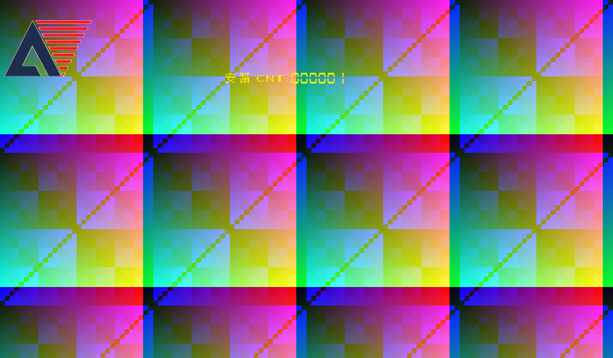

# 2026-10-18：复古、视觉增强与原版 OSD 整合说明

本次以 `main` 的统一工程 `project/` 为基线，加入 Lproject 的复古和视觉增强滤镜，恢复附件触屏例程中的安路水印。八种滤镜、白平衡、感光度、色偏和 RGB 主目标功能共用同一个顶层、触摸入口、DDR 帧缓存和 DSI 输出。最新下载入口始终是 `project/DSI_UNIFIED_SC500_7inch*.bit`。

## 1. 来源和采用范围

| 来源 | 固定版本 / 内容 |
|---|---|
| 主分支 | `dba5b08da509d0e19b8301e49a0babd90cdee5f4`：九页 UI、白平衡、六滤镜、RGB 主目标功能 |
| Lproject | `0dff5b9dbe670c5ade99b0e7c1d01d477ed40479` |
| 复古 | `project/feature_versions/2/touch123_sepia/retro_extension/sepia_core.v`、`sepia_lut.v` |
| 视觉增强 | `project/feature_versions/3/touch_style_balanced/enhance_extension/enhance_core.v`、`enhance_window.v`、`enhance_lut.v` |
| OSD | 用户本次提供的 `lab_touch123_DSI_SC500_7inch.zip` 中 `user_source/hdl_source/osd/` 的四个文件 |

OSD RTL、字符库、Logo ROM 和 Logo HEX 保留附件原字节。来源压缩包和关键文件的 SHA-256 记录在 `project/INTEGRATION_PROVENANCE.json`。Lproject 的算法经过接口适配、公共运算复用和逐像素回归；没有复制它的另一套摄像头、触摸、DDR、诊断顶层。

原图保留当前 main 的白平衡、色偏和亮度路径。Lproject 自身“原图”通路的 Gamma 0.95 / 色度校正没有叠加到当前原图模式。两种新增滤镜处理的是当前 ISP 输出，因此相同传感器场景下不承诺与 Lproject 独立镜像完全同色；相同 RGB 数字输入下，其复古、视觉增强数学处理已与独立参考模型比对。

## 2. 操作与 UI 兼容

沿用 [UI 设计来源](UI_DESIGN_AND_INTEGRATION.md) 的 1024×600 画布、右侧 `x>=560` 设置面板、配色、长按 800 ms、稳定释放 30 ms、逐级回退、色温滑条及二维色偏网格。保留统一版的 page 0～8 编号和所有原参数页。

滤镜页 page 7 使用原来的双列卡片，新增第四行。所有热区左闭右开、上闭下开：

| mode | 功能 | X 热区 | Y 热区 |
|---:|---|---|---|
| 0 | 原图 | `[584,784)` | `[112,176)` |
| 1 | 黑白 | `[800,1000)` | `[112,176)` |
| 2 | 动漫 | `[584,784)` | `[192,256)` |
| 3 | 负片 | `[800,1000)` | `[192,256)` |
| 4 | 像素画 | `[584,784)` | `[272,336)` |
| 5 | 边缘 | `[800,1000)` | `[272,336)` |
| 6 | 复古 | `[584,784)` | `[352,416)` |
| 7 | 视觉增强 | `[800,1000)` | `[352,416)` |

功能页 page 8 的第一行改名为“OSD 水印”，热区仍为 `[584,1000)×[112,176)`；目标跟踪第二行不变。水印和目标开关相互独立。离开页面不清空滤镜、白平衡或功能开关。

文字表仍使用 6 位 text ID：63 从旧固定水印改为“复古”，38 从旧“球体或方块”提示改为“视觉增强”，61 改为“OSD 水印”。自动页和功能页不再重复显示旧识别提示；目标开关、分类算法及热区不受影响。

为了让原版左上角 160×160 Logo 完整可见，预览顶栏的 WB 状态文字右移至 `(176,20)`，手动 K 值至 `(400,20)`，滤镜名称至 `(600,20)`；感光度仍在 `(864,20)`。上下暗栏、设置面板及设置页控件位置不变。生成模板和实际 RTL 已同步更新。


## 3. 原版 OSD 的恢复方式

恢复内容是附件的完整水印：

- 原 160×160 Anlogic Logo，位置 `(0,0)`，包含透明像素位。
- 黄色 `安路 CNT:` 与六位十进制计数，文字原点 `(375,120)`，RGB888 为 `#FFF200`。
- 计数按显示 VSYNC 上升沿递增，`999999` 后回到 `000000`；它是显示帧计数，不是秒数。
- 开关关闭或进入设置页后仍持续计数，返回预览重新开启时不会归零。
- 功能开关保存为原有 `tag_enable` 位。预览页显示水印，设置页暂时隐藏，以免文字跨入右侧面板或 Logo 挡住操作界面。

水印放在 UI 之后，所以原 Logo 和黄色文字不会被顶栏暗化。旧 `FPGA VISION` 字样已去除。所有像素和 VS/HS/DE 同时经过原版 OSD 的两级寄存器，无论开关是否开启，延迟均相同。

下图为原版 OSD 模块回归导出的像素输出，用于核对原 Logo / 字模，不是实物照片或完整统一 UI 截图。



```text
DDR / 1024×600 裁剪
  → RGB 主目标检测与标注（3 拍）
  → 中文 UI（2 拍）
  → 原版 OSD（2 拍）
  → DSI 打包
```

显示配置先在基础视频 VS 上升沿快照，再分别延迟 3 拍和 5 拍供 UI、OSD 使用。一次触摸不能使同帧前后半段出现不同水印使能。目标层也使用同一帧快照。

## 4. 复用与冗余消除

### 公共空间处理

`image_filter_bank_96` 是唯一滤镜选择入口。动漫、边缘、视觉增强共用 `enhance_core` 内的两级行窗口和四像素 Sobel 运算组，不再各自实例化一套边缘检测器。当前工程已删除旧 `edge_detect_96.v`、`cartoon_stylize_96.v`、`rgb_to_gray_96.v` 及其工程登记；历史阶段目录仍保留原实现。

- 视觉增强：可逆 YCoCg → 3×3 保边平滑 → 第二窗口的 Sobel / 亮度与色度平滑 → 暗部保留的细量化 → RGB 共同增益 → 1.25 倍色差 → 柔和轮廓融合。
- 动漫 / 边缘：第一级选择未平滑的中心像素；复用第二级窗口和同一 Sobel 结果。动漫使用四级 RGB 量化及深色描边；边缘使用默认阈值 80。
- 黑白 / 复古：共用一次 `77R+150G+29B` 加权亮度计算。
- 复古：保留 Lproject 的色调 LUT、轻微暗角、逐帧播种的 LFSR 颗粒、四拍处理和饱和裁剪。
- FIFO：新增 RGB 跨域复用已有 `frame_stream_fifo`，没有导入另一份数百行通用 FIFO。

**可见变化**：统一 Sobel 改为逐像素、居中、复制边界的 3×3 窗口。旧 main 使用像素对降采样及因果窗口，首两行 / 行首强制黑边。新边缘和动漫轮廓的精细度、边界和位置会相应改变；不是旧边缘模块的逐字节等价替换。新增复古、视觉增强保留各自算法参考的一致性。

### 公共乘法运算

形状分类器的行矩、中心矩、宽度面积、包围盒面积、线段误差和容差运算，按 FSM 阶段共享一个乘法器。算法判据、输入 / 输出接口和 BALL/CUBE/UNKNOWN 语义不变；增加少量状态周期，23 组分类样例和完整标注视频已验证。

释放的 DSP 用于视觉增强的增益乘法；增益低 9 位用乘法，最高位用精确移位相加。复古保留移位加法树。`gain_product_tb` 穷举乘积，防止定点宽度或符号改变画面。

## 5. 连续处理时钟、帧边界与 DDR

CSI 接收时钟可能在行 / 帧消隐停止，空间窗口需要继续读出复制的末行。因此在当前 WB / 色偏 / 亮度后加入 `filter_clock_bridge`，把 RGB、valid、SOF、EOL、3 位滤镜号作为一个事件送到已有异步 FIFO，在连续的 24 MHz 域完成滤镜、96→128 位打包，再送已有 DDR 写入器。

```text
CSI 域：RAW10 → 去马赛克 → WB / 色偏 / 亮度
  → RGB 事件异步 FIFO
24 MHz 域：八项滤镜 → 128 位打包
  → 帧存储异步 FIFO
DDR 域：四槽帧缓存 → DSI 域裁剪与显示
```

FIFO 深度 1024 个四像素事件；不是整帧缓存。接收侧最终 Gray 指针在写入最后一个事件的同一拍发布，停止 CSI 时钟也不会滞留末字。溢出锁存为错误，使后续采集帧不发布，需复位恢复，避免把损坏帧当成有效画面。

空间路径包含两次行窗口延迟，快速滤镜仍为四拍；相同帧只走选定路径，选择在 SOF 锁存。正常 720p 消隐需足够排空两行和运算流水；测试覆盖末行及最后一个 CSI 边沿后立即停钟。连续无消隐或异常截断帧不能视为受支持的视频时序。

原先 DDR 写入器单独同步“当前模式”，在写入暂停时可能已经指向后续帧。本次把模式放入 SOF 事件的同一个 FIFO，分配槽位时读取该事件保存的模式；四槽标签仍为 12 位，显示模式仍为 3 位。

39 位 UI 配置、19 位 WB 配置及各字段位置完全兼容上一版。新增滤镜使用原来未占用的编号 6 / 7，无需扩展邮箱或槽标签。摄像头分辨率、显示裁剪、引脚和原时钟定义不变。

新增连续处理域后，帧存储 FIFO 的 24 MHz / DDR 用户时钟边界必须按 Gray 同步器检查。SDC 在原文件末尾追加 `PROCESS_DDR_GRAY_CDC`：两个方向的源 Gray 寄存器到第一级同步寄存器限制最大数据路径 7.5 ns（较快时钟的周期），仅取消这一级不适用的相位保持检查；第一级到第二级及后续逻辑继续正常计时。没有放宽原时钟周期、切断整条时钟域或屏蔽像素 / 运算路径。原 SDC 的完整字节仍是新文件前缀，来源清单同时保存前缀与最终约束的校验值。最终约束报告确认两个方向各匹配 10 条路径，最大数据路径约束均生效，未被忽略。

## 6. 修改入口

| 职责 | 工程内路径 |
|---|---|
| 菜单热区和模式记忆 | `user_source/hdl_source/ui/wb_ui_control.v` |
| UI 布局 / 文字源 | `tools/wb_ui_overlay.template.v`、`tools/generate_wb_ui.py` |
| 公共滤镜选择 | `user_source/hdl_source/isp/image_filter_bank_96.v` |
| 公共空间窗口 / Sobel / 增强 | `isp/enhance_window.v`、`isp/enhance_core.v` |
| 复古曲线 / 颗粒 / 暗角 | `isp/sepia_core.v`、`isp/sepia_lut.v` |
| 共享灰度 / 定点乘积 | `isp/filter_arithmetic.v` |
| RGB 跨时钟 | `isp/filter_clock_bridge.v` |
| OSD 原版资产 | `user_source/hdl_source/osd/` |
| 乘法器时分复用 | `target/red_shape_classify.v` |
| 视频实际连线和配置延迟 | `user_source/hdl_source/design_top_wrapper.v` |

表内 `isp/`、`target/` 相对 `user_source/hdl_source/`。修改文字或版式后运行 UI 生成器，必须同时提交模板、生成脚本、overlay、font.v、font.hex，避免下次生成覆盖修改。

## 7. 验证和验收

本次实际执行项目和最终资源 / 时序结果见 [构建报告](../project/BUILD_REPORT.md)，完整日志位于 `project/build_evidence/integration_20261018/`。主工程的交付清单为 `project/INTEGRATION_MANIFEST.json`，并核对三份 TD 工程文件的相对依赖和唯一编译顺序。

仿真检查包含八滤镜参考像素、两帧完整 720p 新滤镜、模式帧锁存、随机空拍、原版 OSD 透明像素与六位计数进位 / 回卷、停钟末字、DDR 暂停、界面九页、形状分类、白平衡、色偏和原有视频链路回归。仿真 FIFO / DDR 行为模型不能替代实际 DDR PHY 或 MIPI 电气验证。

上板建议顺序：原图 → WB / 增益 / 色偏 → 八项滤镜逐个选择 → 原版 OSD 开关及回退 → 原图下的红绿蓝目标 → 连续切换和复位。目标识别继续从显示侧已应用滤镜的图像取样，黑白 / 负片 / 复古等会影响颜色阈值，应在原图下验收目标功能。没有新增未经过滤镜的独立检测旁路。

本次没有连接实体开发板，无法以仿真图替代相机画质、触摸方向或实物识别率确认。
