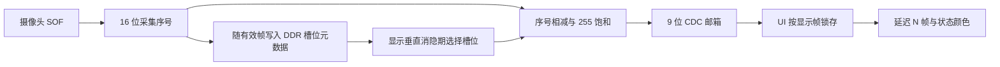

# 采集到显示的延迟可视化

## 1. 目标与当前实现

本功能在不增加整帧缓存、不改变 1024×600 视频比例的前提下，把摄像头画面的“帧新鲜度”显示在预览页底栏。显示格式为 `延迟 N 帧`：

- 灰色 `延迟 --- 帧`：尚未得到第一帧有效画面；
- 绿色：0～2 帧；
- 黄色：3～4 帧；
- 红色：5 帧及以上；
- 计数显示上限为 255，超过后保持 255。

显示区域为预览页 `x=520～711, y=562～585`。它位于原有半透明底栏内，不占用视频画布，也不改变摄像头裁剪或缩放比例。

## 2. 测量定义

摄像头每出现一次 SOF（帧开始）就在摄像头时钟域产生一个 16 位递增序号 `C`。当前 `C` 以 Gray 码双触发器同步到 DDR 域；每帧自己的二进制序号则随 SOF 标记穿过像素 FIFO。当一帧完整写入 DDR 并通过长度、MIPI 错误和 FIFO 溢出检查后，该帧开始时的序号会写入对应 DDR 槽位元数据 `S`。因此，即使像素 FIFO 因 DDR 拥塞而积压，`C` 仍反映真实摄像头进度。

屏幕在垂直消隐期确定下一帧读取槽位时，锁存：

```text
frame_latency = (C - S) mod 65536
```

因此，计数表示屏幕即将显示的画面距离当前摄像头采集进度相差多少个帧周期。被丢弃的坏帧也会推进 `C`，所以坏帧或链路拥塞造成的画面陈旧会真实反映到数值中。16 位回绕按模运算处理，只要实际积压小于 32768 帧就不会产生歧义。

在 60 fps 输入下，1 帧周期约为 16.67 ms，可用 `N × 16.67 ms` 粗略估计缓冲与处理造成的延迟。该数值不包含曝光在一帧内的相位、传感器逐行扫描时间、DSI 面板扫描和液晶响应时间，因此它是稳定、可重复的数字链路实时性指标，并非光学端到端毫秒计。

## 3. 数据通路



元数据与图像使用相同的槽位编号。延迟在 DDR 时钟域内计算后，通过已有的最新值握手邮箱传到 DSI 时钟域；UI 只在显示帧边界更新一次，避免一帧内部数字或颜色撕裂。

## 4. 代码结构

| 文件 | 作用 |
|---|---|
| `project/user_source/hdl_source/video_in.v` | 在摄像头域生成序号，以 Gray 码同步当前进度，并保存四个 DDR 槽位的 16 位序号 |
| `project/user_source/hdl_source/frame_latency_meter.v` | 模运算、有效门控、8 位饱和和显示帧采样 |
| `project/user_source/hdl_source/video_out.v` | 在槽位读取地址生效的同一拍锁存模式和延迟 |
| `project/user_source/hdl_source/design_top_wrapper.v` | 连接槽位元数据，并通过 9 位邮箱跨到 DSI 时钟域 |
| `project/tools/wb_ui_overlay.template.v` | 预览页位置、颜色阈值和按帧锁存 |
| `project/tools/generate_wb_ui.py` | 生成“延迟”“帧”、数字和无效符号字形 |
| `project/verification/latency_tb.sv` | 验证普通差值、序号回绕、饱和、无效状态和采样保持 |

## 5. 验证方案

### RTL 自动验证

1. `latency_tb` 检查 1 帧、5 帧、16 位回绕、超过 255 饱和以及无有效画面。
2. `frame_store_tb` 检查序号与正确 DDR 槽位一起传递，并覆盖坏帧、短帧和 FIFO 溢出恢复。
3. `overlay_tb` 渲染全部 UI 页面，检查延迟输入不会产生未知像素，且配置在显示帧内保持稳定。
4. TD 完整综合、布局布线和最终建立/保持时序必须通过后，才生成新的可上板 bitstream。

本次 TD 6.2.168116 全流程已通过：SWNS `+0.013 ns`、HWNS `+0.020 ns`，LUT6 `19591/21216`、Slice `20251/21216`、ERAM20K `86/108`、DSP `40/40`。本机没有 Vivado XSIM，新增 RTL 测试已写入回归入口但尚未实际运行；当前结论包括完整顶层编译与物理实现，不包括开发板和新增 testbench 的运行结果。

### 开发板验收

1. 上电后等待画面稳定，预览页应显示绿色 `延迟 1 帧` 或邻近值。
2. 暂时制造 DDR 读写压力或输入坏帧，确认计数会上升并按阈值变色；恢复后应回落。
3. 长按进入设置再返回，确认计数继续更新且视频比例不变。
4. 用高帧率相机同时拍摄被摄 LED/计时器和显示屏，测量光学端到端延迟；将结果与帧差计数对照，用于记录传感器和面板带来的固定附加量。

## 6. 后续扩展接口

如果后续需要毫秒显示，可在 DDR 时钟域给 SOF 和显示槽位加载事件增加自由运行时间戳，再通过相同邮箱传给 UI。现有槽位序号仍应保留，它更容易定位“缓存积压了几帧”，也便于区分固定扫描延迟和异常排队。
