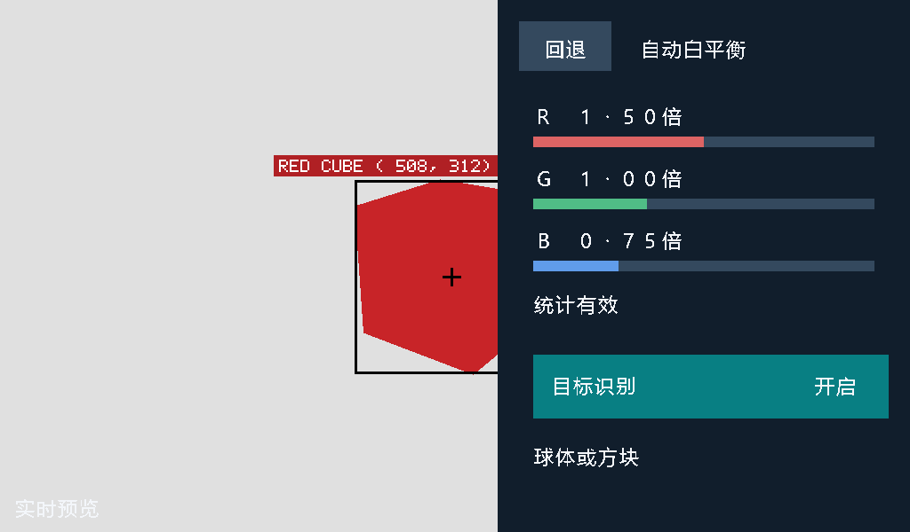
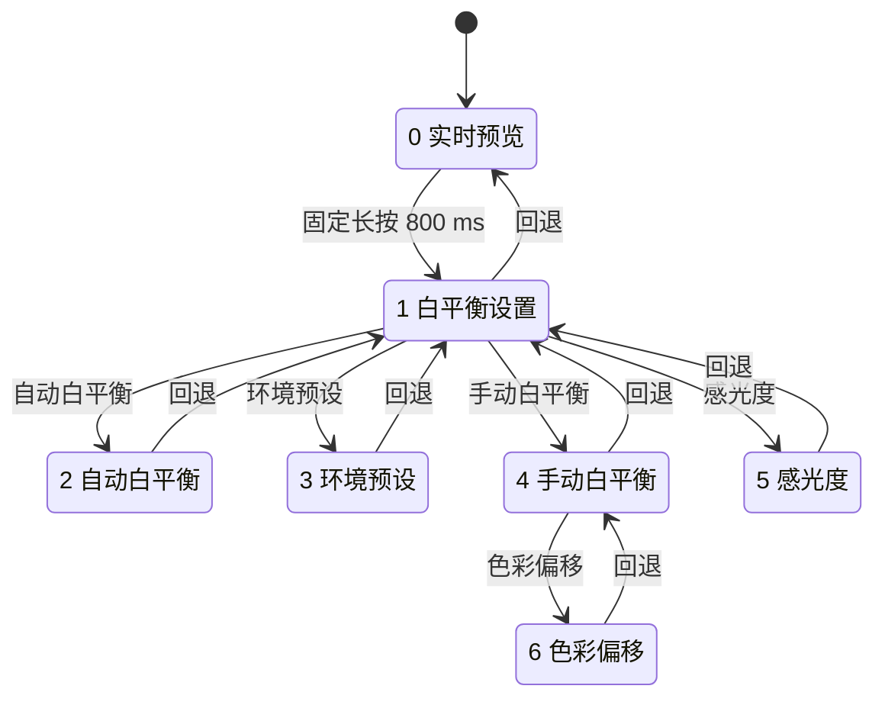
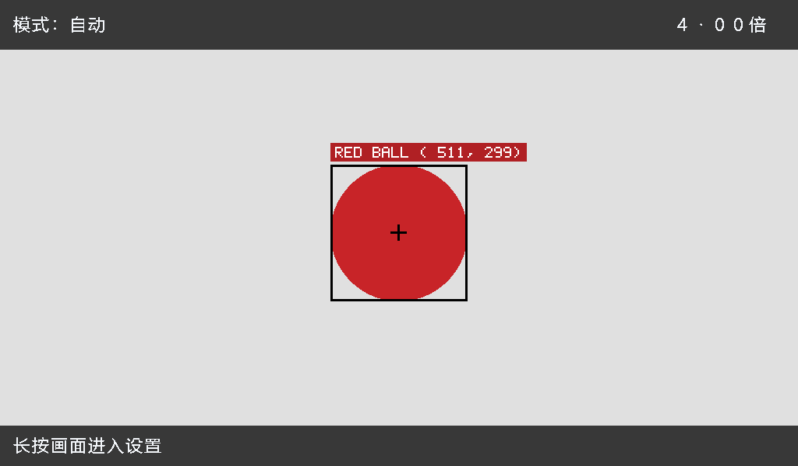

# 红色目标识别工程：UI 设计说明与 AI 整合约定

编写日期：2026-10-17。对象为 `lab_shape_target_DSI_SC500_7inch` 的实际 RTL、界面生成模板和随包渲染图。本文先说明当前已实现的界面，再给出与六模式工程整合时的接口要求；后面的整合建议尚未实现为新的统一工程。

源包：`lab_shape_target_DSI_SC500_7inch.zip`。SHA-256：`7c50ea8d9ad8f118cf08025fb7e1f561e61a3e37b6fba2e5bbbeda0cb185a317`。原始源码和包内 README / BUILD_MANIFEST 保持不变。

## 1. 工程边界与阅读入口

当前识别对象限于**单个主要红色区域**的球体或方块外观。输出为 `RED BALL`、`RED CUBE`、`UNKNOWN`、`NO TARGET`；没有其他颜色、三角形类别、独立多目标框或通用物体识别。单目相同投影的平面图形也可能得到同一分类。

另一个并列的 `lab_touch6_pixel8_bright_DSI_SC500_7inch` 是六种图像效果工程，采用点按循环切换，当前没有本说明中的七页设置 UI。两份工程目前独立打开、构建和下载。

| 职责 | 实际文件 |
|---|---|
| 页面、手势、触摸热区、按钮状态 | [ui/wb_ui_control.v](../lab_shape_target_DSI_SC500_7inch/user_source/hdl_source/ui/wb_ui_control.v) |
| 页面画面、颜色、文本、网格、帧快照 | [ui/wb_ui_overlay.v](../lab_shape_target_DSI_SC500_7inch/user_source/hdl_source/ui/wb_ui_overlay.v) |
| 推荐修改的版面源模板 | [tools/wb_ui_overlay.template.v](../lab_shape_target_DSI_SC500_7inch/tools/wb_ui_overlay.template.v) |
| 中文标签和字模生成 | [tools/generate_wb_ui.py](../lab_shape_target_DSI_SC500_7inch/tools/generate_wb_ui.py) |
| 触屏通信 / 坐标映射 / 配置跨时钟 | [touch/](../lab_shape_target_DSI_SC500_7inch/user_source/hdl_source/touch) |
| UI、识别、ISP、邮箱的实际连接 | [design_top_wrapper.v](../lab_shape_target_DSI_SC500_7inch/user_source/hdl_source/design_top_wrapper.v#L243) |
| 目标框、标签、中心十字和视频同步 | [target/red_target_video.v](../lab_shape_target_DSI_SC500_7inch/user_source/hdl_source/target/red_target_video.v) |
| 分类算法 | [target/red_shape_classify.v](../lab_shape_target_DSI_SC500_7inch/user_source/hdl_source/target/red_shape_classify.v)、[red_target_detect.v](../lab_shape_target_DSI_SC500_7inch/user_source/hdl_source/target/red_target_detect.v) |

下文的 HDL 路径均相对识别工程 `user_source/hdl_source/`。

## 2. 画布、版式和视觉样式

- 有效画布固定 **1024×600**，原点为屏幕左上角，X 向右、Y 向下。摄像头 1280×720 中心裁剪偏移为 `(128,60)`；UI 与检测坐标统一使用裁剪后的屏幕坐标。
- 预览页覆盖全屏。顶栏 `y<64`、底栏 `y>=548` 将原像素的 RGB 通道各右移两位作为暗底；其余区域保留实时视频。
- 设置页保留左侧 `x<560` 视频，右侧 `x>=560` 为固定深色面板，面板宽 464 像素。不能把显示裁剪尺寸改为 560×600；右侧是对完整视频的覆盖。
- 设置页共用回退按钮 `[584,688)×[24,80)`，文字从 `(612,44)` 起；页标题从 `(720,44)` 起。左下角 `(16,562)` 标“实时预览”。
- 普通中文文字采用 **24×24** 字格；当前中文不是任意 Unicode 实时绘制，见第 8 节。

| 元素 | RGB888 |
|---|---|
| 主文字 | `#F3F6FA` |
| 设置面板 | `#111E2C` |
| 未选中卡片 | `#26394D` |
| 选中卡片 / 主操作 | `#087F83` |
| 回退按钮 / 次要轨道 | `#34495E` |
| 滑条已选部分 / 轴选择标记 | `#16B8AD` |
| 目标标签 | 红底 `#B02024`、白字 `#FFFFFF` |
| 无目标标签 | 深底 `#15202B`、白字 `#FFFFFF` |
| 框线与中心十字 | `#000000` |

自动页的现有 RTL 渲染图如下，右侧开关保持与触摸控制热区一致。图中左侧为测试图形，不是相机照片。



## 3. 页面状态与导航

`O_page[2:0]` 是页面编号；`O_mode[1:0]` 是白平衡模式，两者相互独立。回退和打开感光度页面不会自动重置白平衡模式。

| page | 页面 | 进入动作及状态影响 | 回退 |
|---:|---|---|---|
| 0 | 实时预览 | 复位默认页；固定单指长按约 800 ms 打开设置 | — |
| 1 | 白平衡设置 | 显示自动、环境预设、手动白平衡、感光度四个入口 | 0 |
| 2 | 自动白平衡 | 进入时 `mode=0`；显示实际 RGB 增益、统计状态及目标识别开关 | 1 |
| 3 | 环境预设 | 打开页面时不改变模式；点击具体预设才设置 `mode=1` 与 K 索引 | 1 |
| 4 | 手动白平衡 | 进入时 `mode=2`，恢复记忆的自定义 K 索引；可进入色彩偏移 | 1 |
| 5 | 感光度 | 改摄像头模拟增益；白平衡模式保持 | 1 |
| 6 | 色彩偏移 | 调 B/A、G/M 两轴，并改变实体键的上下文 | 4 |



复位后控制器状态：`page=0`、`mode=0`、`preset=1`、`index=30`、`gain=80`、`detect_enable=0`、`ab=0`、`gm=0`、`key_axis=0`。这对应自动白平衡、记忆 K=5500、默认 4× 模拟增益、识别关闭、色偏归零。

目标识别开关是独立的记忆状态。顶层实际使能条件为 `detect_enable && (wb_mode == 0)`；切到预设或手动模式会暂停识别，重新进入自动模式恢复之前的开关状态。

## 4. 触摸、热区与实体键

所有热区表均采用 **左闭右开、上闭下开**：`[x0,x1)×[y0,y1)`，避免相邻控件边界同时命中。画面元素的视觉边框不一定等于热区边框。

### 4.1 基础手势

触摸链为 `gt911_pointer` → `touch_coord_map` → `wb_ui_control`，均由系统域处理。坐标映射读取 GT911 保存的宽高，必要时交换竖屏坐标，映射到 1024×600；支持顶层的 X/Y 反转参数。宽高无效时回退到 1024×600；不要直接把原始 16 位触摸坐标送进热区逻辑。

预览页长按期间，任一坐标轴相对起点移动 **超过 24 像素**就取消进入设置；这不是欧氏距离判定。多指或触屏离线也取消当前手势。设置页按钮在新一轮有效按下时触发，一直按住不会反复打开页面；只有明确设置为重复的增减/方向按钮例外。一次动作后需全部松开并稳定约 **30 ms**，长按进入设置后不会在同一按压中继续点穿菜单。

K 滑条与二维网格采用按下捕获：必须从相应热区内开始，随后拖出仍更新并限制在合法端点，直到松手。普通按钮没有这种拖动捕获。

### 4.2 共用与页面入口热区

| 页面 / 控件 | X 范围 | Y 范围 | 动作 |
|---|---|---|---|
| 全部设置页 / 回退 | `[584,688)` | `[24,80)` | 按第 3 节返回 |
| page 1 / 自动 | `[584,1000)` | `[112,176)` | page 2，`mode=0` |
| page 1 / 环境预设 | `[584,1000)` | `[192,256)` | page 3 |
| page 1 / 手动 | `[584,1000)` | `[272,336)` | page 4，`mode=2`，恢复自定义 K |
| page 1 / 感光度 | `[584,1000)` | `[352,416)` | page 5 |
| page 2 / 目标识别 | `[600,1000)` | `[400,472)` | 每次新按下翻转开关 |
| page 4 / K 滑条捕获区 | `[584,1000)` | `[252,340)` | 调 K 并记忆 |
| page 4 / 色彩偏移 | `[584,1000)` | `[472,536)` | page 6 |

page 3 的四个预设热区与 page 1 的四行相同，从上到下为：

| preset | 文字 | K 值 | index |
|---:|---|---:|---:|
| 0 | 暖色灯光 | 3000 | 5 |
| 1 | 日光 | 5500 | 30 |
| 2 | 阴天 | 6500 | 40 |
| 3 | 阴影 | 7500 | 50 |

K 显示值为 `2500 + 100*index`，范围 `index=0..75`。滑条中心 X 为 `600 + 5*index`；触摸换算为 `x<=600 → 0`、`x>=975 → 75`，中间 `(x-600+2)/5` 取整。可视轨道为 `[600,976)×[284,300)`，捕获热区比轨道更宽。

### 4.3 感光度页

| 控件 | X 范围 | Y 范围 | 输出 |
|---|---|---|---|
| 1× | `[584,712)` | `[112,168)` | `gain=16` |
| 2× | `[728,856)` | `[112,168)` | `gain=48` |
| 4× | `[872,1000)` | `[112,168)` | `gain=80` |
| 减少 | `[608,736)` | `[300,388)` | `gain-1`，下限 16 |
| 增加 | `[856,984)` | `[300,388)` | `gain+1`，上限 89 |
| 恢复默认 | `[584,1000)` | `[432,488)` | `gain=80` |

显示的是传感器**模拟增益倍率**，不是经过标定的 ISO。有效范围 1.000×～5.125×，界面四舍五入显示两位小数；不能把 `gain` 索引直接当作线性倍率。

增减按钮按下立即执行一次；保持约 500 ms 后开始累计重复计时，再每 120 ms 执行一次，因此第一次额外重复约在 620 ms。实体键有约 20 ms 消抖和独立长按重复计时。两键同时产生事件时不执行互相冲突的增减。

### 4.4 二维色彩偏移页

| 控件 | X 范围 | Y 范围 | 动作 |
|---|---|---|---|
| 网格捕获区 | `[667,934)` | `[167,434)` | 同时更新 AB 与 GM |
| 左上 AB 读数 | `[584,656)` | `[104,164)` | 实体键选择 AB 轴 |
| 右上 GM 读数 | `[912,1000)` | `[104,164)` | 实体键选择 GM 轴 |
| B / 左 | `[584,656)` | `[268,332)` | AB 减 1，选择 AB 轴 |
| A / 右 | `[944,1016)` | `[268,332)` | AB 加 1，选择 AB 轴 |
| G / 上 | `[768,832)` | `[104,164)` | GM 加 1，选择 GM 轴 |
| M / 下 | `[768,832)` | `[436,496)` | GM 减 1，选择 GM 轴 |
| 归零 | `[584,1000)` | `[520,576)` | AB=GM=0，保留 K |

网格为 19×19 档，AB、GM 都是 **5 位有符号数**，合法范围 -9..+9。左 B 为 AB 负方向，右 A 为正；上 G 为 GM 正方向，下 M 为负。网格节点间距 14 像素，中性点 `(800,300)`；光标位置为 `x=800+14*AB`、`y=300-14*GM`，例如 B5/G6 为 `AB=-5, GM=+6`。

方向按钮按下立即移动一格，并支持与增益按钮相同的长按重复；移出原按钮范围就停止重复。此页中实体减键沿选中轴向 B 或 M 移动，加键向 A 或 G 移动，**不会同时修改感光度**。离开 page 6 后，实体键恢复增益调节。色偏值及所选轴保持记忆，色偏算法仅在 `mode=2` 下应用。

## 5. 配置总线与跨时钟接口

不要只按模块名把其他工程信号接进来；先核对字段宽度、含义、符号和帧生效位置。

### 5.1 UI 显示配置：34 位

顶层 `u_ui_config` 将系统域状态送到 `S_dsi_tx_clk`；打包顺序如下：

```verilog
{key_axis, ab, gm, detect_enable, page, wb_mode, preset, index, gain, touch_online}
```

| 位段 | 宽度 | 含义 |
|---|---:|---|
| `[33]` | 1 | 实体键轴：0=AB，1=GM |
| `[32:28]` | 5 | AB，有符号补码 |
| `[27:23]` | 5 | GM，有符号补码 |
| `[22]` | 1 | 识别开关记忆值 |
| `[21:19]` | 3 | page，0..6 |
| `[18:17]` | 2 | WB 模式：0 自动、1 预设、2 手动 |
| `[16:15]` | 2 | 预设编号 |
| `[14:8]` | 7 | K 索引，0..75 |
| `[7:1]` | 7 | 模拟增益寄存器索引，16..89 |
| `[0]` | 1 | GT911 在线状态 |

`touch/config_mailbox.v` 使用保持 payload 的请求/应答邮箱；快速连续修改会合并为最新值，不保证传送每一个中间状态。页面和增益等持久状态可使用它；不要把一次性操作脉冲直接当作它的 payload。

### 5.2 相机处理配置：19 位；传感器增益：7 位

`u_wb_config` 从系统域到 CSI 域，打包 `{ab, gm, wb_mode, index}`：`AB[18:14]`、`GM[13:9]`、`mode[8:7]`、`index[6:0]`。图像处理在相机帧开始整体锁存配置。

`u_gain_config` 独立传输 7 位 `gain` 到相机寄存器控制域，再由 `camera_gain_apply.v` 进行 SOF 同步、限频和最新目标合并。不要把感光度页操作直接变成任意时刻的传感器寄存器写入。

### 5.3 自动白平衡遥测：37 位

`u_wb_telemetry` 从 CSI 域送到显示域：`valid[36]`、`R_gain[35:24]`、`G_gain[23:12]`、`B_gain[11:0]`。通道值是 Q10，1024 表示 1×；界面按 `(Q10*100+512)>>10` 显示两位小数倍率。此遥测总线与 UI 配置是不同通路。

自动页三条进度条从 `x=600` 开始，最大可视宽度 384；上下位置分别为 `[154,166)`、`[224,236)`、`[294,306)`。状态位为真显示“统计有效”，否则显示“等待稳定帧”。遥测代表实际 WB 增益，不是用户选择的 K 值，也不是相机模拟增益。

## 6. 视频叠加顺序与目标标注

显示侧链路为：

```text
DDR 读出与 1024×600 裁剪 / 测试图
  → 原基础 RGB、VS、HS、DE
  → red_target_video：先统计未标注彩色像素，再叠目标标注（3 拍）
  → wb_ui_overlay：中文 UI 与状态栏（2 拍）
  → RGB24 转 RGB32 → DSI 打包与 PHY
```

识别结果必须从**UI 和目标标注之前**的图像计算，否则红色按钮、红底标签也会进入检测。RGB、VS、HS、DE 必须整体经过一致的流水延迟。顶层还把整帧 34 位 UI 配置延迟三拍，与 `red_target_video` 输出对齐；不能只对齐像素却把 UI 使能或页码接成未经延迟的最新状态。

`wb_ui_overlay` 在显示帧开始后的第一有效像素锁存整份 UI 配置及遥测，覆盖 VS 与首个像素同拍的情况。快速触摸不能使同一帧出现两个页码或撕裂的多字段配置。

目标标注的行为：

- 显示前一完整显示帧的结果；初次确认需连续两个完整帧。类别在第一有效像素锁存，消隐分析未完成则显示 UNKNOWN，不能让标签在有效区中途变类。
- 框线黑色、厚 3 像素；中心十字向四周各延伸 10 像素，宽度约 3 像素。中心按外接框中心向下取整，坐标为屏幕坐标。
- 标签大小固定 **252×24**。预览页可用宽度 1024，设置页可用宽度 560；标签从框左侧起，超过可用右边缘就左移。`top>=92` 时放在 `top-28`；否则优先放 `bottom+4`，空间仍不足则放 `y=64`。
- 无目标时取消框和十字，显示深底白字 `NO TARGET`；标签在可用宽度内居中，`y=516`。
- 非预览页仅允许 `x<560` 的目标标注进入输出，中文面板最后叠加。不能改成固定左上角结果框而破坏现有跟随目标的设计。



其他现有渲染图：[透视方块](../lab_shape_target_DSI_SC500_7inch/ui_preview/red_cube_perspective.png)、[旋转方块](../lab_shape_target_DSI_SC500_7inch/ui_preview/red_cube_rotated.png)、[三角形为 UNKNOWN](../lab_shape_target_DSI_SC500_7inch/ui_preview/unknown_triangle.png)、[NO TARGET](../lab_shape_target_DSI_SC500_7inch/ui_preview/no_target.png)。这些是 RTL 合成场景渲染，不能作为实物识别率证据。

## 7. 页面行为与算法的关系

UI 只维护请求和显示状态，不直接替代图像算法。K 值、AB/GM 和模拟增益分属不同处理路径；色偏归零不重置 K，回退不清空参数，切白平衡模式不丢失已记忆的识别开关和手动参数。

识别开关只控制现有红色目标算法；改变标签“目标识别”不会扩大检测颜色或类别。识别前的白平衡和亮度会影响红色阈值，新增特效时尤其要保留清晰的检测取样位置。

## 8. 字模和界面代码的修改入口

`tools/generate_wb_ui.py` 定义中文标签及动态数字的 glyph 映射；`tools/wb_ui_overlay.template.v` 定义布局、颜色、动态字段和视频流水。生成器一次产生三个相互匹配的文件：

```text
user_source/hdl_source/ui/wb_ui_overlay.v
user_source/hdl_source/ui/wb_ui_font.v
user_source/hdl_source/ui/wb_ui_font.hex
```

应在模板中改布局、在生成器中改文字，然后重新生成；只手改生成后的 overlay 会在下次生成时被覆盖。生成器需要 Pillow，并引用 `C:/Windows/Fonts/msyh.ttc`。已有字模已打包，正常 TD 构建不需要 Python 或外部字体。

每个中文字模占 24 位宽、32 行 ROM 地址，其中 24 行可见；字形编号 7 位，上限 128 个字符。文本 ID 为 6 位，动态 K / 倍率 / RGB 增益 / 轴读数由代码产生，不是字符串渲染引擎。新文字需要同时考虑字符表、文本 ID、控件宽度和热区。

目标英文标签使用独立的 `target/target_ascii_font.v`，5×7 基础字模放大两倍，字符单元宽 12，不能直接按中文 24 像素字格计算英文标签宽度。

字体 ROM 的默认路径相对 TD 运行目录。搬移工程时应整体保留 `td_project/` 与 `user_source/` 的相对关系；不要只复制 overlay 和 font.v 而遗漏 HEX。

## 9. 与六模式工程整合时的建议

本节是下一阶段设计输入，**当前两个 ZIP 尚未合成同一个工程或镜像**。

六模式编号定义在 [isp/isp_frame_select_96.v](../lab_touch6_pixel8_bright_DSI_SC500_7inch/user_source/hdl_source/isp/isp_frame_select_96.v)：

| 图像效果编号 | 已实现效果 |
|---:|---|
| 0 | 提亮彩色原图 |
| 1 | Sobel 白边黑底 |
| 2 | 提亮彩色原图 + 原有 Logo / 文字 / 帧计数 |
| 3 | 灰度 |
| 4 | 彩色负片 |
| 5 | 固定 8×8、RGB332 的 256 色像素画 |

当前六模式工程由 `touch/touch_mode_cycle.v` 的有效点按产生 3 位 `S_requested_mode`。经 `mode_mailbox`、相机帧起始选择、DDR 四槽模式标签传到显示侧，非法编号在帧开始回到 0。像素画模式的取色是 8×8 块的左上角，`BRIGHTEN_ENABLE` 是编译参数，当前没有对应的运行时 UI 开关。

建议整合时遵守以下约定：

1. 分别保留 **page（页面）**、**wb_mode（白平衡）**、**image_mode（六效果）**。三者的数值虽然重叠，含义完全不同；不能把六模式值塞进现有 2 位白平衡字段，也不能直接把页面 5 解释成像素画。
2. 让一个系统域控制器拥有触摸事件和图像模式请求。七页 UI 的长按 / 点击与六模式的“全屏点按即循环”不能同时消费同一次触摸。可由新页面选择图像效果，复用现有六模式的帧边界与槽标签链路；这是需要实现的新行为。
3. 新增 `image_mode` 时，明确扩展配置总线字段，并同步更新顶层打包、邮箱 WIDTH / RESET_VALUE、overlay 解包、仿真和文档。保持 AB/GM 有符号字段及原 34 位布局的可追溯映射。不要截断原 3 位图像模式或四个 DDR 槽的模式标签。
4. 选择并记录检测算法取样点。若希望灰度、负片模式也可显示红色目标框，可从效果变换之前的彩色路径统计，再在等延迟的最终画面上叠框；不能把灰度或反相 RGB 直接送入原红色阈值并声称检测含义不变。这条彩色旁路尚未在附件中实现。
5. 以识别工程现有 UI 和帧保护为基线逐模块迁入特效，比较两个 `design_top_wrapper`、`isp_top`、`video_in`、`video_out` 的接口和实现，不能仅因文件名相同就覆盖。两份工程使用不同的触摸前端和模式链。
6. 识别工程随包报告的 DSP 已为 **40/40**。新增处理后需重新检查资源、布局布线和时序；不能把两个独立镜像的构建通过视为合并后也会通过。

## 10. 验证入口与交接要求

识别包的 `verification/run_sim.ps1` 包含 25 个测试入口。与 UI 整合直接相关的用例为：`ui_control_tb`、`coord_tb`、`pointer_bus_tb`、`overlay_tb`、`target_ui_tb`、`shift_ui_tb`、`telemetry_tb`、`shape_video_tb`、`shape_classify_tb`、`mailbox_tb`。完整 CSI、存储和显示链还有独立回归。

界面改动后至少核对：页面进入/回退与模式记忆、热区边界、长按不穿透、拖动捕获、多指/离线取消、实体键上下文、配置字段符号与跨域一致性、VS 与首像素同拍、UI/识别的 RGB 与同步延迟、标签不侵入面板，以及四种结果文本。合入特效后还要覆盖六种编号、帧中改变请求和 DDR 槽标签。

本次文档依据源码和现有渲染图生成；本次上传只重新核对归档文件、哈希和工程依赖，没有重新运行这 25 项 RTL 仿真或重新生成烧写镜像。原包的构建记录见 [BUILD_REPORT.md](../lab_shape_target_DSI_SC500_7inch/BUILD_REPORT.md)，原始操作与识别边界见 [README.md](../lab_shape_target_DSI_SC500_7inch/README.md) 和 [SHAPE_RECOGNITION.md](../lab_shape_target_DSI_SC500_7inch/docs/SHAPE_RECOGNITION.md)。
