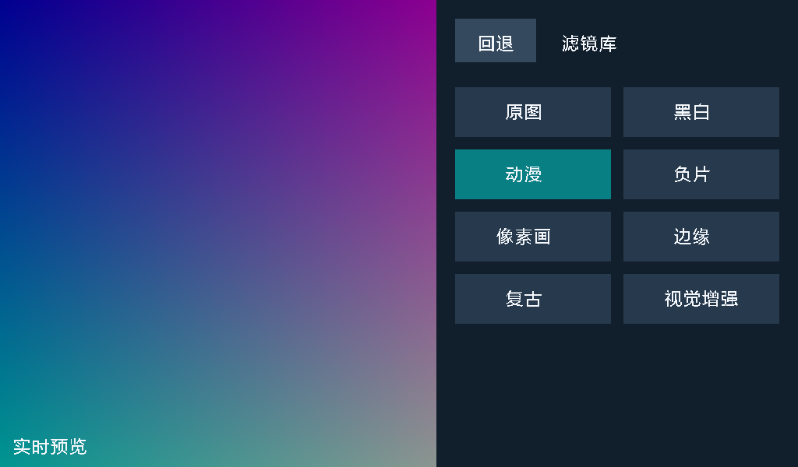
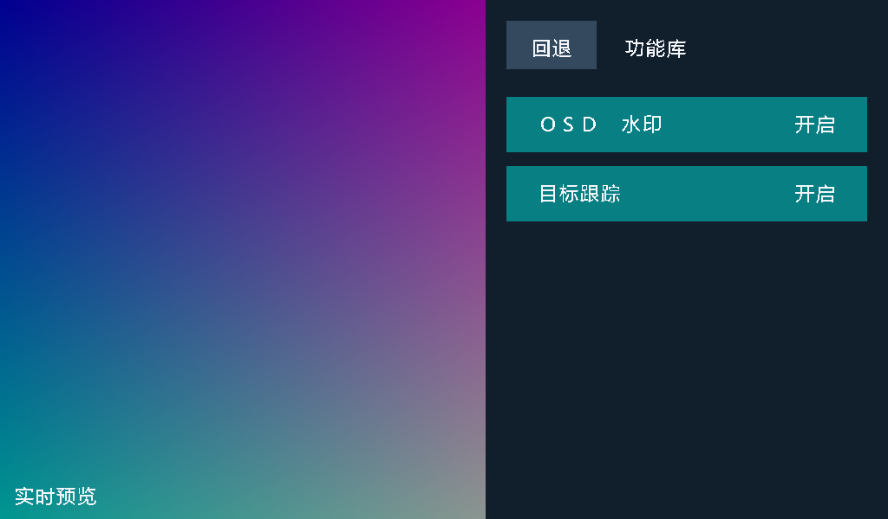

# 统一版 UI、滤镜与功能库

当前版本合入 Lproject 的复古、视觉增强，并恢复用户触屏例程中的原版安路水印。完整算法、接口、兼容变化和来源固定版本见 [详细整合说明](../INTEGRATION_20261018.md)；构建与验证结果见 [构建报告](../../project/BUILD_REPORT.md)。

预览页底栏只显示实时 `延迟 N 帧`，详细运行计数集中在新增的诊断页。该值把摄像头 SOF 序号随有效图像绑定到 DDR 槽位，并在显示垂直消隐期计算帧差；0～2 帧显示绿色、3～4 帧黄色、5 帧以上红色。定义、边界和上板测量方法见 [延迟可视化设计](../LATENCY_VISUALIZATION.md)；诊断页见 [预览与诊断页面](../DIAGNOSTICS_UI.md)。

## 页面与操作

| page | 页面 | 操作 / 回退 |
|---:|---|---|
| 0 | 实时预览 | 固定单指长按 800 ms 进入设置 |
| 1 | 白平衡设置 | 自动、预设、手动、感光度、滤镜库、功能库、诊断信息；回退到 0 |
| 2 | 自动白平衡 | RGB 实际增益、统计状态、目标开关；回退到 1 |
| 3 | 环境预设 | 3000 / 5500 / 6500 / 7500 K；回退到 1 |
| 4 | 手动白平衡 | 2500～10000 K、色彩偏移入口；回退到 1 |
| 5 | 感光度 | 1 / 2 / 4 倍、加减、恢复默认；回退到 1 |
| 6 | 色彩偏移 | B/A、G/M 二维网格和实体键轴选择；回退到 4 |
| 7 | 滤镜库 | 四行两列、八种滤镜；回退到 1 |
| 8 | 功能库 | OSD 水印、目标跟踪独立开关；回退到 1 |
| 9 | 诊断信息 | 当前/峰值帧龄、丢弃帧、读取溢出、显示欠读；回退到 1 |

画布为 1024×600，设置面板仍覆盖 `x>=560`，保留原视频裁剪和比例。配色、热区约定、长按移动取消、多指 / 离线取消、30 ms 松手稳定和滑条 / 网格捕获沿用 [原 UI 设计来源](../UI_DESIGN_AND_INTEGRATION.md)。

滤镜页前三行保持原图 / 黑白、动漫 / 负片、像素画 / 边缘，第四行新增复古 / 视觉增强。新行热区为 `[584,784)` 与 `[800,1000)`，`y=[352,416)`。预览 WB 文字右移至 x=176，为原版左上角 Logo 留空间；K 值 x=400、滤镜名 x=600，增益 x=864。

## 水印与目标功能

OSD 开关恢复原例程 160×160 Anlogic Logo、`安路 CNT:`、黄色六位显示帧计数。水印仅在预览页显示，设置页隐藏但继续计数；开关和回退不重置计数。原 Logo、字模及 RTL 与用户附件一致，替代旧 FPGA VISION 顶栏标签。

RGB 主目标功能沿用当前 main：每帧选择红 / 绿 / 蓝数量最多的一类，复用一套区域与形状分类器，输出一个框、中心点和 BALL / CUBE / UNKNOWN / NO TARGET。它是基于颜色和二维外观的实验功能；没有通用物体检测或多目标连通域。滤镜会改变检测输入的颜色，目标功能应在原图下验收。

## 配置接口

39 位显示配置保持：`[38]` 实体键轴、`[37:33]` AB、`[32:28]` GM、`[27]` 跟踪、`[26]` 水印、`[25:22]` page、`[21:20]` WB 模式、`[19:18]` 预设、`[17:11]` K 索引、`[10:4]` 感光度、`[3:1]` 滤镜、`[0]` 触屏在线。延迟遥测使用独立 9 位邮箱：`[8]` 有效，`[7:0]` 饱和帧差。

3 位滤镜编号依次为 0 原图、1 黑白、2 动漫、3 负片、4 像素画、5 边缘、6 复古、7 视觉增强。WB 邮箱仍为 19 位，四槽 DDR 模式标签仍为 12 位。page、WB 模式、滤镜编号保持独立。

UI 修改源是 `project/tools/wb_ui_overlay.template.v` 和 `generate_wb_ui.py`；生成后的 overlay / font.v / font.hex 应一起提交。当前字体使用 8 位字形编号、13 位 ROM 地址，普通中文单元 24×24；文本标签编号扩展为 7 位，以容纳延迟动态标签。

## 本版变化与验证边界

动漫、边缘、视觉增强共用空间窗口和 Sobel；黑白与复古共用加权亮度；跨时钟缓冲复用原 FIFO；形状分类器分阶段复用乘法。原图、白平衡、触摸、裁剪和引脚保持当前设计。逐像素 Sobel 代替旧像素对近似，细节和边界显示会有变化。

验证入口和上板清单见 [整合说明第 7 节](../INTEGRATION_20261018.md#7-验证和验收)。日志证明的仿真 / 编译结果与未执行的实物验收分开记录。
