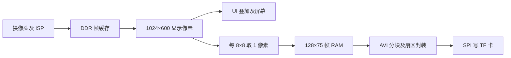

# TF 卡录像版设计与开发记录

## 当前功能与取舍

录像版保留摄像头采集、全屏预览、白平衡、增益、触屏设置和水印开关；在“功能库”增加录像按钮。录像从 **UI 叠加前** 的 1024×600 画面取样，屏幕继续全屏显示。因 PH1P35 原完整版仅余约 438 个 Slice，录像版关闭实验性目标跟踪和 ISP 滤镜，相关入口在录像版停用。原完整版的顶层默认参数仍为 `RECORDING_BUILD=0`，单独的 `recording_top` 才启用写卡逻辑。

写入的视频不包含屏幕上的 UI 与水印；水印仍可在预览中显示。

这是一段无声视频，尺寸 128×75（与 1024×600 预览同比例）、约 10 fps、24 位未压缩 AVI。单次最多 1800 帧，即约 3 分钟。录像版只支持一段录像；录完后需要重新准备 TF 卡，才能开始下一段。

## 硬件与数据流

底板手册的 TF 引脚为 CD=D8、DATA0=E6、DATA1=E7、DATA2=D5、DATA3=E5、CMD=C9、CLK=D9。SPI 模式使用 DATA0=MISO、DATA3=CS、CMD=MOSI、CLK=SCLK；DATA1 和 DATA2 保持高电平。引脚定义在 `user_source/constraints_source/pin.adc`。



帧缓存为 9600×24 bit，在显示时钟域写入、25 MHz 系统时钟域读取。每 6 个显示帧尝试采集一帧；写卡时暂停新帧采集，避免覆盖未写完的数据。若 TF 卡写入较慢，实际帧率可能低于目标值，AVI 仍按 10 fps 回放，此时回放时长会短于实际录制时间；这一点需要上板测量。录制状态机每完成一帧便回写 AVI 头，使意外断电后已完成的帧仍有机会被读取。

## 文件格式与卡片准备

板上不实现 FAT32 文件创建。`tools/tf_prepare.py` 生成一个 **64 MiB 的整卡镜像文件**，内部有 FAT32 分区及连续预分配的 `RECORD.AVI`。这个程序只创建普通文件，不会自动操作物理磁盘。写卡核心使用块地址，实体卡应为 SDHC/SDXC（通常容量不小于 2 GB），不适用于旧式 SDSC。需要使用可信的磁盘镜像工具将镜像写入卡；**写入会覆盖卡上原有内容**，操作前先备份，并核实目标设备。

本次已生成 `D:\FPGA\record_card.img`，可以直接作为写卡输入；若想重新生成，请先另选新文件名。

```powershell
cd D:\FPGA\Main_Proj\project
python tools\tf_prepare.py D:\FPGA\record_card.img
```

用 BitWriter 下载 `TF_RECORDING_7inch_compress.bit`，插入准备好的卡后上电。长按预览画面进入设置，打开“功能库”，点“录制视频”。按钮变为“停止录制”；结束时点它，等待“保存中”变为“已完成”后再拔卡。电脑上打开 `RECORD.AVI`。TF 卡无卡、格式不对、未准备或扇区写入超时，界面会显示不可录制或错误状态。重新录制前需重新生成并写入准备镜像。

AVI 使用 `BI_RGB` 的 BGR24 顶向下画面。每帧为 `00db` 块（28800 字节图像），后接 `JUNK` 块补齐至 57×512 字节；文件头正好占 1 个扇区。此布局使每帧和文件头均能直接按扇区写入。停止时更新 RIFF 长度、两处帧数及 `movi` 长度，尾部预留空间由 RIFF 长度排除。文件头的 `TFREC1` 标记还用于识别准备好的卡；正常停止后改为 `TFDONE`，防止重新上电误覆盖录像。

## 工程结构

- `user_source/hdl_source/recording/tf_avi_recorder.v`：抽样、跨时钟缓冲、扇区写入与 AVI 文件头更新。
- `user_source/hdl_source/recording/sd_card_*.v`、`spi_master.v`：改编自本地官方例程 `Official/2_Example/18_sd_card_audio` 的 SPI 扇区控制器。修正了初始化完成信号过早置位的问题。
- `user_source/hdl_source/recording/avi_header.hex`：512 字节头部 ROM，由准备脚本生成。
- `user_source/hdl_source/recording/recording_top.v`：独立录像版顶层。
- `tools/create_recording_project.py`：从完整版 TD 工程生成录像版工程文件。
- `td_project/tf_recording.sdc`：将原工程约束中的实例路径映射至录像版顶层 `u_core`。
- `build_recording.ps1`：运行综合、布局布线与时序检查，成功后输出 `TF_RECORDING_7inch.bit`。

```powershell
cd D:\FPGA\Main_Proj\project
powershell -NoProfile -ExecutionPolicy Bypass -File .\build_recording.ps1
python tools\create_tf_manifest.py
python verification\check_project.py
```

## 验证记录与待上板项目

`python tools/verify_avi.py` 检查准备镜像的 MBR、FAT 链、文件起始扇区与头部 ROM，并构造三帧测试视频。OpenCV 解码器识别为 128×75、10 fps，三帧颜色均正确。该检查验证磁盘镜像与 AVI 结构，未覆盖 TF 卡电气和实卡持续写入。应在开发板上用已备份的卡验证：卡检测极性、初始化、录制/停止、电脑播放、持续写入时的实际帧率、拔卡异常和温度/供电稳定性。实际可下载镜像还必须通过 TD 综合、布局布线和最终时序检查。

2026-10-21 使用 TD 6.2.168116 完整构建录像版成功：最终 Slice 17084/21216（80.52%）、ERAM20K 64/108、DSP 28/40；建立时序 SWNS +0.101 ns，保持时序 HWNS +0.020 ns，均无违例。`TF_RECORDING_7inch_compress.bit` 的 SHA-256 为 `15059FD399B3B5A8C9163B9700DED982FC43FE388BEA8989138C04C6E994AA12`。这是工具链结果，尚未做实体卡与开发板测试。
